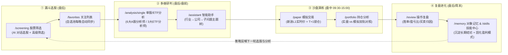

# TradingAgents-CN 系统使用与实战提效指南

> **核心理念**：本系统不是“预测明日涨跌的水晶球”，而是一套将 **「选股初筛 → 多智能体研判 → 盘中沙盘演练 → 复盘归因与记忆固化」** 串成闭环的 **AI 赋能系统化交易工作台**。

---

## 一、 一张图看懂系统核心闭环（四步飞轮）

---

## 二、 八大核心模块极简操作手册

| 阶段 | 模块名称与路由 | 核心作用 | 三步极简操作要点 |
| :--- | :--- | :--- | :--- |
| **1. 选股** | **股票筛选** `/screening` | 从全市场 `5,567` 只 A 股中快速缩小观察圈 | 1. 默认用 **「智能筛选」** 直接输入自然语言需求（如*“低估值、ROE>12%、近期放量的制造业股票”*）； 2. 需精确卡指标阈值时切换 **「高级筛选」**； 3. 筛出 `10~15` 只标的直接加入关注列表。 |
| **2. 跟踪** | **股票关注列表** `/favorites` | 维护核心自选股池并自动保持数据最新 | 1. 按行业或策略分组管理自选股； 2. 系统后台 `favorites_data_sync` 定时同步最新行情与基础数据； 3. 从列表直接一键跳转「单股分析」或「股票详情」。 |
| **3. 研判** | **单股 / ETF 分析** `/analysis/single` | 多智能体团队协同研究与多空辩论 | 1. 输入代码（自动识别 `A股` 或 `ETF`），**先点「数据检验」**（若缺数据可一键单股同步）； 2. 选择 **分析深度（1~5 级）** 与 **分析师团队**； 3. 生成报告后可在 `/reports` 导出 `Markdown / Word / PDF / JSON`。 |
| **4. 追问** | **智能助手** `/assistant` | 针对细分疑问做结构化专题深挖 | 1. 在左侧「研究主题」按 **`行业 → 公司 → 子问题`** 建立树状主题； 2. 针对分析报告中的疑点（如存货周转、同业竞争）连续追问； 3. 右侧摘要栏自动提炼每个分支的核心结论。 |
| **5. 演练** | **模拟交易** `/paper` | 零资金风险验证买卖择时与仓位纪律 | 1. **仅在连续竞价时段（`09:30–11:30`、`13:00–15:00`）** 下单，系统按需直连新浪 L1 实时报价； 2. 严格执行 **A 股 T+1 锁仓**、当日 `[最低价, 最高价]` 防穿价校验与停牌拦截（`security_suspended`）； 3. 非交易时段自动返回 `outside_continuous_session`，杜绝拿旧收盘价充当盘中成交价。 |
| **6. 持仓** | **持仓分析** `/portfolio` | 实盘持仓与模拟持仓双轨盈亏监控 | 1. 在 **「💰 用户持仓」** 记录或同步真实持仓，在 **「模拟持仓」** 查看沙盘持仓； 2. 对比总市值、持仓成本、浮动盈亏与行业集中度； 3. 盘后估值基于最新可得日线参考价，与盘中成交价严格区分。 |
| **7. 复盘** | **操作复盘** `/review` | 量化统计交易胜率、盈亏比与操作得失 | 1. 支持切换 **「持仓操作复盘」** 与 **「模拟交易复盘」**； 2. 自动汇总 **总交易数、胜率、盈亏金额、平均持仓天数**； 3. 结合交易前后的K线走势，定位“买早了、卖飞了还是止损不坚决”。 |
| **8. 沉淀** | **对象记忆 & Skill** `/memory` · `/skills` | 将单次经验转化为长期记忆与可复用技能 | 1. **`/memory` 股票对象记忆**：按 `市场+标的+日期+结论` 结构化保存历次分析洞察（需开启 `MEM0_ENABLED`）； 2. **`/skills` Skill 中心**：创建或用 AI 生成专属分析技能（如“高股息红利排雷清单”），绑定至后续分析流程。 |

---

## 三、 分析深度与分析师团队怎么选？（黄金搭配表）

在 `/analysis/single` 中，切忌“每只股票都无脑开 5 级全选”（耗时且浪费 Token）。建议按以下 **场景矩阵** 精准搭配：

| 实战场景 | 推荐深度 | 预计耗时 | 推荐分析师组合 | 适用时机 |
| :--- | :---: | :---: | :--- | :--- |
| **场景 A：选股池快速初筛** （从 10 只筛到 3 只） | **1~2 级** 快速/基础 | `2~6 分钟` | `市场分析师` + `基本面分析师` | 每日盘后对 `/screening` 筛出的候选股做第一轮排雷 |
| **场景 B：波段建仓立项** （主力推荐模式） | **3 级** 标准分析 🎯 | `4~8 分钟` | `市场` + `基本面` + `新闻` + `板块分析师` | 准备纳入次日交易计划的核心关注标的 |
| **场景 C：重仓/分歧期多空辩论** （防确认偏误） | **4~5 级** 深度/全面 🏆 | `6~16 分钟` | **全选 6 大 A 股分析师** （含 `大盘` + `板块` + `社媒`） | 准备重仓介入、财报披露期或市场多空分歧剧烈时 |
| **场景 D：宽基/行业 ETF 配置** | **3 级** 标准分析 | `4~8 分钟` | 切换市场为 `ETF 基金` 系统自动锁定：`ETF分析师` + `市场` + `新闻` | 评估 `510300`、`588000`、`159915` 等场内 ETF 趋势与情绪 |

> **每次分析前的必做动作**：输入股票代码后，先点击日期右侧的 **「数据检验」** 按钮。系统会自动核验该标的在 MongoDB 中的 **基础信息、历史日线（AKShare 每日 `18:30` 自动同步）、财务数据与行情状态**；如发现单股缺数据，可在弹窗内一键点击「同步缺失数据」。

---

## 四、 从三个维度用系统实现“能力与收益率跃迁”

### 1. 如何提升【股市分析能力】？—— 建立“自上而下 + 多空互搏”框架
* **告别单维盲人摸象**：散户常犯的错误是“看图形态好就买，忽略财报暴雷或板块退潮”。在系统中同时勾选 **`大盘分析师` + `板块分析师` + `市场分析师` + `基本面分析师`**，强制自己先看 **宏观水位（大盘）→ 中观景气（板块）→ 微观质地与买点（基本面+技术面）** 是否形成三振共鸣。
* **用多空辩论克制“一厢情愿”**：当你强烈看好某只股票时，开启 **4 级深度分析**。重点阅读报告中的 **空头论据与风险提示**——如果空头指出的风险（如毛利率连续下滑、大股东减持、板块高位滞涨）你无法证伪，立刻放弃或减半仓位。

### 2. 如何提升【盘后复盘能力】？—— 从“情绪化懊悔”升级为“证据链对账”
* **事前留痕（防事后诸葛亮）**：每次买入（无论是实盘还是模拟盘）前，必须先跑一份 `/analysis/single` 报告。系统会在 `/reports` 与 `/memory` 中记录你 **交易当天的客观数据、支撑位/压力位预判与买入逻辑**。
* **事后双维归因（`/review` 操作复盘）**：
  1. **认知归因**：打开买前报告对比实际走势——是基本面/催化事件判断错了，还是大盘系统性杀跌？
  2. **执行归因**：查看 `/review` 统计面板的 **胜率** 与 **盈亏比**——如果报告提示支撑位买、压力位卖，而你实际操作是“突破追高买、跌破支撑死扛”，说明问题出在交易纪律而非分析能力。

### 3. 如何提升【实际收益率】？—— 遵循“期望值公式”与“沙盘过滤机制”
股市长期收益由期望值公式决定：
$$E = P_{\text{win}} \times R_{\text{win}} - (1 - P_{\text{win}}) \times R_{\text{loss}}$$
其中 $P_{\text{win}}$ 为胜率，$R_{\text{win}}$ 为平均盈利幅度，$R_{\text{loss}}$ 为平均亏损幅度。系统从三个环节直接拉升 $E$ 值：
1. **提高胜率 $P_{\text{win}}$（漏斗式减法）**：用 `/screening` + `/analysis/single` 过滤掉基本面瑕疵、停牌风险及逆板块周期的杂毛股，减少无效出手次数；
2. **放大盈亏比 $R_{\text{win}} / R_{\text{loss}}$（事前定风控）**：利用分析报告给出的关键技术支撑位设置硬止损线（截断 $R_{\text{loss}}$），利用基本面估值区间与趋势跟踪拿住主升浪（放大 $R_{\text{win}}$）；
3. **零成本试错与技能复利（`/paper` + `/skills`）**：
   - 任何新学的选股战法，**先在 `/paper` 模拟交易中用盘中真实 L1 报价和 T+1 规则跑满 20 笔**；
   - 在 `/review` 中确认胜率与盈亏比为正期望后，再将这套判断标准在 `/skills` 中沉淀为个人专属 **Skill**，最后才切入实盘资金。

---

## 五、 每日 / 每周黄金标准作业流（SOP 速查表）

| 时段 | 建议耗时 | 核心动作与使用页面 | 严格禁忌（避坑指南） |
| :--- | :---: | :--- | :--- |
| **🌅 盘前准备** `09:00–09:25` | `15 分钟` | 1. 打开 `/favorites` 与 `/portfolio` 查看持仓股与自选股； 2. 打开 `/reports` 回顾昨晚生成的目标股买卖区间与风控线。 | ❌ 忌盘前临时搜陌生股票冲动制定买入计划。 |
| **⚡ 盘中交易** `09:30–11:30` `13:00–15:00` | `按需执行` | 1. 仅按盘前计划在 `/paper` 执行模拟验证或实盘操作； 2. 利用 `/paper` 实时报价核验盘中价格走廊与停牌状态。 | ❌ 忌盘中频繁跑长耗时 5 级分析追涨杀跌； ❌ 注意 A 股买入当日 **T+1 锁仓** 不可卖出。 |
| **🌙 盘后深研** `18:30 以后` *(日线已同步)* | `30~45 分钟` | 1. **18:30 后** AKShare 全市场日线同步完毕，用 `/screening` 筛选异动标的； 2. 对 `1~3` 只核心标的在 `/analysis/single` 先点 **「数据检验」** 再跑 **3 级标准分析**； 3. 用 `/assistant` 主题树追问细节，更新次日观察池。 | ❌ 忌在 `15:00–18:30` 之间未点「数据检验」就默认当日日线已全部入库； ❌ 忌把 ETF 详情页离线日线图表当成盘中可成交证明。 |
| **📅 周末进化** `周六 / 周日` | `45~60 分钟` | 1. 在 `/review` 复盘本周实盘与模拟盘交割单，检查胜率与盈亏比； 2. 在 `/memory` 核对历史预判准确率； 3. 在 `/skills` 将本周验证有效的排雷或择时规则固化为 Skill。 | ❌ 忌只看账户总盈亏而不对单笔失败交易做归因。 |

---

## 六、 当前系统运行边界说明（运维实测确认）

1. **历史日线底座**：由 `akshare_daily_sync` 于每个交易日 `18:30` 自动同步入库（当前覆盖 `5,567 / 5,577` 只 A 股，覆盖率 `99.82%`）。
2. **模拟盘盘中实时报价**：仅在连续竞价时段（`09:30–11:30`、`13:00–15:00`）且许可有效期内启用新浪 L1 按需直连；支持沪深主板/科创/创业板（`60/68/00/30`）及沪深场内 ETF/LOF（`50/51/52/56/58/15/16/18`），暂不支持北交所（`92/83/87/43`）。
3. **安全降级承诺**：当证券停牌（`security_suspended`）、不在连续交易时段（`outside_continuous_session`）或上游超时时，模拟交易严格拒绝成交并给出明确原因码，**绝不静默回退使用历史旧收盘价撮合成交**。

